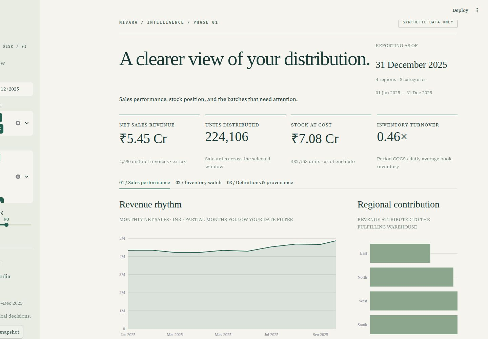
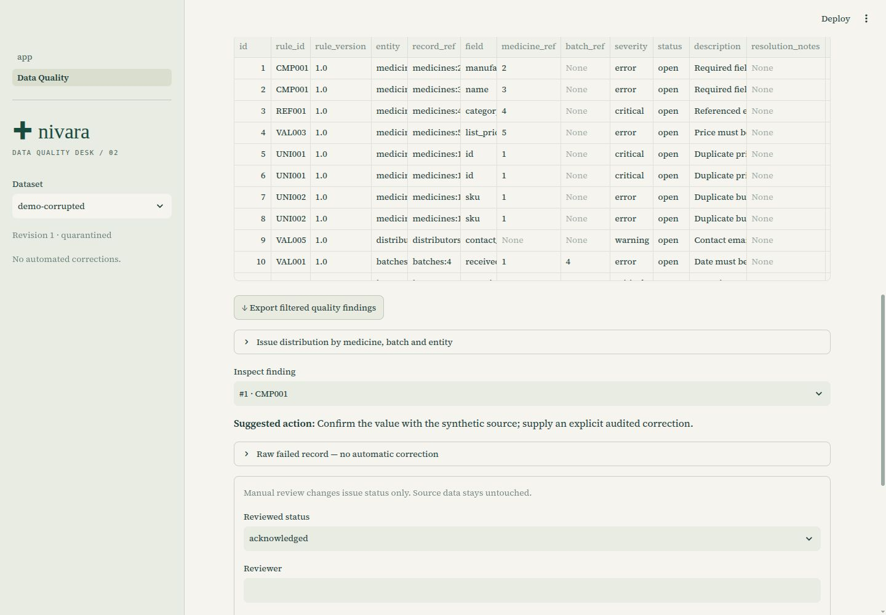
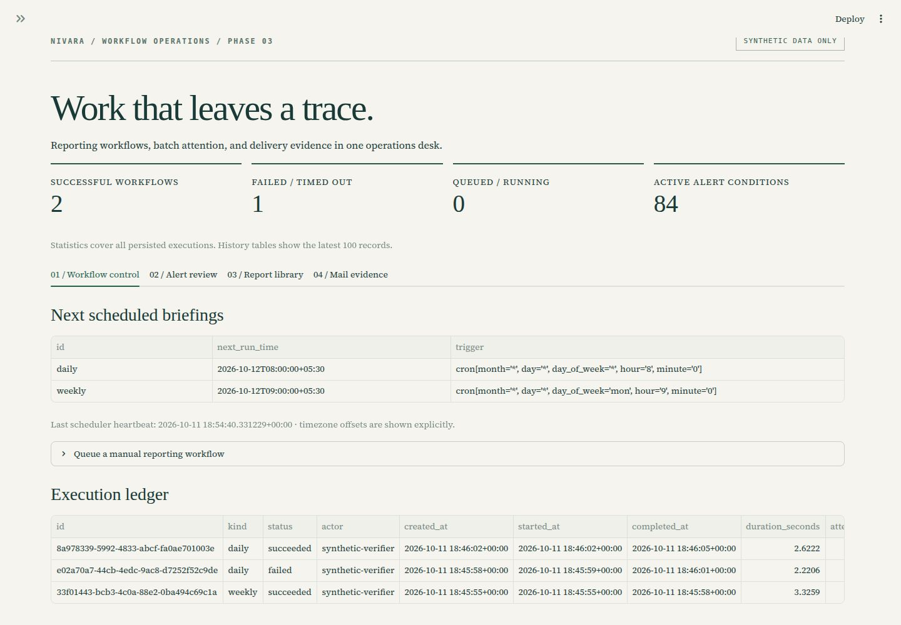
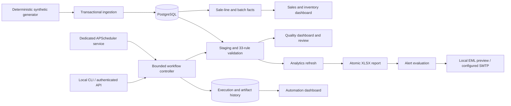

# Nivara · Pharma Data & Automation Suite

**Sales intelligence, data-quality review, and scheduled reporting in one local application.**

Nivara is a Python and PostgreSQL portfolio project for pharmaceutical Data Analyst, Data Engineer, and Automation Engineer roles. It follows a fictional distribution operation from batch receipts and invoice lines through stock reconciliation, quality review, and automated Excel briefings.

**Python 3.12 · PostgreSQL 16 · SQLAlchemy · Pandas · Streamlit · Plotly · APScheduler · openpyxl · Docker Compose · pytest**

[2:30 captioned walkthrough](docs/recruiter/nivara-demo.mp4) · [Architecture](#architecture) · [Quick start](#quick-start) · [Source review](docs/recruiter/SOURCE_REVIEW.md) · [Final summary](FINAL_SUMMARY.md)

> All data is synthetic. No patient information, real customers, or clinical decisions. This is a trusted-local portfolio simulation, not validated clinical, regulatory, GxP, or production ERP software.



## The business questions

- Which regions, categories, and medicines contribute to net revenue?
- What stock remains at a selected reporting date, and how much is approaching expiry?
- Which source records fail validation, and what review evidence explains their status?
- Did a scheduled briefing succeed, and can its report and execution history be inspected?

## What the implementation demonstrates

| Area | Implementation | Evidence |
| --- | --- | --- |
| Relational modeling | Eight business tables; foreign keys, checks, indexes, and composite warehouse constraints | [Schema](src/pharma_suite/schema.py), [SQL](sql/001_foundation.sql) |
| Data engineering | Fixed-seed synthetic generation, FEFO allocation, stock reconciliation, atomic ingestion | [Generator](src/pharma_suite/generate.py), [database writes](src/pharma_suite/db.py) |
| BI analytics | Separate sale-line and batch facts; integer-cent calculations; historical stock reconstruction and daily average inventory | [Analytics](src/pharma_suite/analytics.py), [KPI definitions](docs/KPIS.md) |
| Data quality | 33 versioned rules, six scoring dimensions, quarantine, reviewed corrections, revision checks, and controlled approval | [Quality engine](src/pharma_suite/quality/engine.py), [review workflow](docs/data_quality.md) |
| Automation | Single scheduler, durable requests, idempotency keys, bounded workers, retry history, alerts, and XLSX artifacts | [Controller](src/pharma_suite/automation/workflow.py), [automation guide](docs/automation.md) |
| Local deployment | Four health-checked services, persistent database/report storage, authenticated API, preview-first mail | [Compose](compose.yaml), [API](src/pharma_suite/automation/api.py) |

## Screens and demonstration

### Data quality desk

The clean demo scores 100%. The deliberately corrupted demo identifies 19 findings across 13 failing records. Review status does not silently repair source data or bypass approval.



### Automation desk

Schedules, execution attempts, alert review, report downloads, and local email previews share one operations page. A dedicated scheduler owns execution; opening another dashboard session does not create another scheduler.



The [2:30 demo video](docs/recruiter/nivara-demo.mp4) is a captioned walkthrough assembled from actual local dashboard captures. It has no voice track or simulated clicks. [The narration script](docs/recruiter/DEMO_SCRIPT.md) supports recording a personal spoken version.

## Architecture



Business facts, quality evidence, and automation history live in PostgreSQL. XLSX and EML files live in a persistent report directory and are checked against registered SHA-256 hashes before download. Migrations for Phases 2 and 3 are additive. See the [architecture guide](docs/ARCHITECTURE.md) for the relational model and tradeoffs.

## Dataset and verified results

Seed **20251011** generates **24 months**, January 2024–December 2025, across four Indian regions. The inventory snapshot is **31 December 2025**. Money is INR; revenue is ex-tax and inventory is valued at acquisition cost.

| Entity | Rows |
| --- | ---: |
| Categories / medicines | 8 / 120 |
| Distributors / warehouses | 24 / 4 |
| Batches / inventory snapshots | 1,920 / 1,920 |
| Sales invoices / sale items | 8,820 / 31,549 |
| **Total business rows** | **44,365** |

The annual sample workbook was reopened with openpyxl and checked against independent PostgreSQL queries: **INR 54,539,450.97 net revenue**, **482,753 closing units**, and **INR 70,823,412.56 closing stock at cost**. These are simulated business values, not measured commercial impact.

**Verification:** 92 tests passed, 0 failed, 0 skipped in the latest recruiter review on 13 October 2026. Ruff lint and format checks also passed. Tests include actual PostgreSQL transactions and hand-verified KPI fixtures. See [review evidence](docs/recruiter/verification.json) and the earlier [Phase 3 execution evidence](docs/verification_phase3.json).

## Quick start

Install Git, Docker Engine, and the Compose plugin. Clone the repository, then start the local services:

```bash
git clone https://github.com/MojoisDev/nivara-pharma-data-suite.git
cd nivara-pharma-data-suite
# Preserve an existing local configuration.
test -f .env || cp .env.example .env
# Set AUTOMATION_API_TOKEN locally if you want authenticated API access.
# The dashboards do not require the API token.
POSTGRES_PORT=55433 APP_PORT=8502 docker compose -p pharma-phase1-compose up --build -d
POSTGRES_PORT=55433 APP_PORT=8502 docker compose -p pharma-phase1-compose ps
```

On this workstation, Compose v1 is installed: substitute `docker-compose` for `docker compose`. Its `ContainerConfig` recreation workaround is documented in [setup and troubleshooting](docs/setup.md).

Open [sales and inventory](http://127.0.0.1:8502/), [data quality](http://127.0.0.1:8502/Data_Quality), or [automation](http://127.0.0.1:8502/Automation). The API is at `127.0.0.1:8503`; only `/health` is unauthenticated. PostgreSQL is bound to `127.0.0.1:55433`.

A fresh business database seeds automatically. Populate the optional clean/corrupted quality demos:

```bash
POSTGRES_PORT=55433 APP_PORT=8502 docker compose -p pharma-phase1-compose exec app \
  pharma dq validate --dataset demo-clean
POSTGRES_PORT=55433 APP_PORT=8502 docker compose -p pharma-phase1-compose exec app \
  pharma dq validate --dataset demo-corrupted
```

Queue an annual briefing:

```bash
POSTGRES_PORT=55433 APP_PORT=8502 docker compose -p pharma-phase1-compose exec scheduler \
  pharma auto trigger --kind weekly --key recruiter-annual-2025 \
  --actor portfolio-reviewer --notes 'Synthetic annual demonstration' \
  --start 2025-01-01 --end 2025-12-31
```

Reports appear in the Automation page and `data/reports/`. Default schedules are daily at **08:00** and Monday at **09:00**, **Asia/Kolkata**. `MAIL_MODE=preview` opens no SMTP connection. Do not enable real delivery until the SMTP review finding is addressed.

For native Python, SQLite demo mode, configuration, schema details, screenshot capture instructions, and recovery commands, use [the full setup guide](docs/setup.md).

## Tests

```bash
python3.12 -m venv .venv
.venv/bin/pip install -r requirements.lock
.venv/bin/pip install --no-deps -e .
.venv/bin/ruff check .
.venv/bin/ruff format --check .
.venv/bin/pytest -q
```

Without `TEST_DATABASE_URL`, PostgreSQL tests skip. For the complete suite, create a **dedicated disposable PostgreSQL database**, then set that URL before running pytest. The [setup guide](docs/setup.md) contains the tested local command. Do not use the portfolio/business database: some integration tests replace its business tables. A missing environment variable is a skip, not proof of PostgreSQL correctness.

## Scope and known limits

The design targets one trusted local operator and one workflow worker. It does not claim distributed scheduling, authenticated electronic signatures, or clinical validation. Offline schedule occurrences are not backfilled. Stock calculations model receipts and sales; returns, transfers, and disposal movements are outside the model.

The [source audit](docs/recruiter/SOURCE_REVIEW.md) records one confirmed SMTP cleanup/retry defect and a test-database safety gap. Keep mail in preview mode and use a disposable database for tests. Microsoft Excel GUI compatibility, live SMTP delivery, and multiuser production load were not verified. Historical data is identified as historical; missing import timestamps are reported rather than invented.

## Repository guide

```text
src/pharma_suite/    Generation, database, analytics, quality, and automation
sql/                Initialization, additive migrations, and KPI queries
dashboard/          Three Streamlit operations pages and shared styling
tests/              Unit, dashboard, regression, and database integration tests
scripts/            Application startup
config/             Non-secret validation and automation settings
data/               Synthetic sources and ignored runtime report artifacts
docs/               Architecture, setup, KPI contracts, evidence, and screenshots
docs/recruiter/     Source review, demo, verified resume bullets, and interview notes
```

