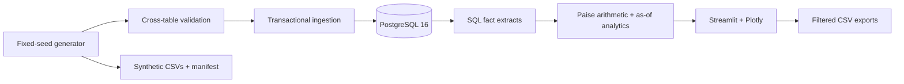
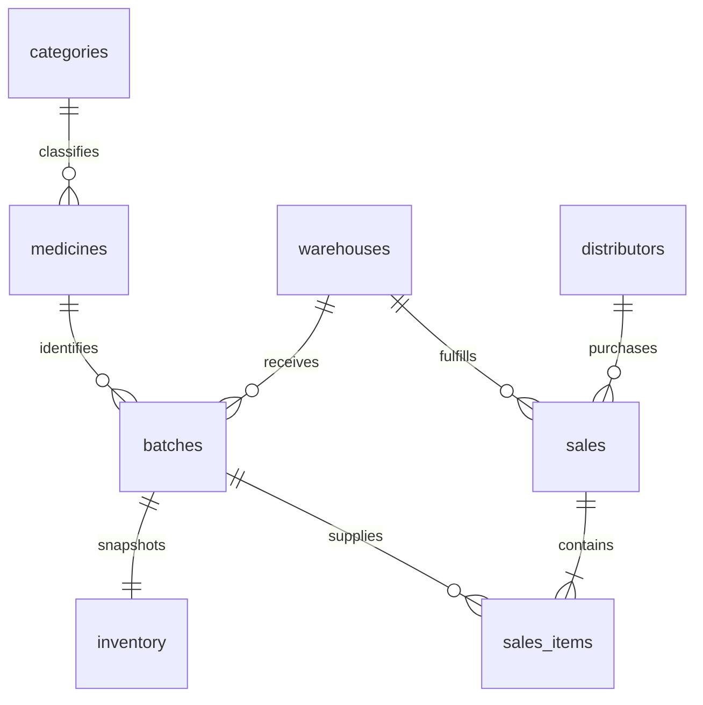

# Phase 1 architecture

## Boundaries

- `generate.py`: pure deterministic generator and whole-dataset validation, no database writes.
- `schema.py`: SQLAlchemy Core tables, keys, indexes and scalar constraints. No ORM needed.
- `db.py`: dialect setup and atomic refresh. PostgreSQL advisory transaction lock serializes suite
  writers; rollback preserves the previous dataset on insert failure. Readers use repeatable read
  to extract two facts from the same database generation. SQLite is explicitly a local demo/test path.
- `analytics.py`: SQL facts, integer-paise aggregation, date/filter rules, reconstructed inventory,
  exact daily average and expiry cohorts. Dashboard delegates calculations to this tested module.
- `cli.py`: installed `pharma` entry point for generate/init/ingest/verify.
- `dashboard/app.py` and `style.css`: presentation and exports. The sales desk is read-only; the Phase 2 page provides explicit reviewed issue status changes and revalidation.
- `sql/001_foundation.sql`: version 1 PostgreSQL schema initialization; mirrors `schema.py`.
- `sql/queries/`: independently executable PostgreSQL KPI queries with SQLAlchemy named parameters.
- `tests/`: deterministic/reconciliation, constraints, hand-calculated KPIs, Streamlit interaction,
  PostgreSQL rollback and SQL KPI parity.

## Relational schema

| Table | Primary key | Important rules |
| --- | --- | --- |
| categories | id | Unique non-null name |
| medicines | id | Category FK; unique SKU; positive list price |
| distributors | id | Unique name; region in North/South/East/West |
| warehouses | id | Unique name; region in North/South/East/West |
| batches | id | Medicine/warehouse FKs; unique batch number; positive receipt/cost; manufacture ≤ received ≤ expiry |
| inventory | batch_id | Batch FK; one closing snapshot per batch; nonnegative held quantity |
| sales | id | Distributor/warehouse FKs; unique invoice number; sale date indexed |
| sales_items | id | Composite invoice/warehouse and batch/warehouse FKs; positive units/price; unique invoice-batch pair |

Inventory's warehouse and medicine are derived from the batch; storing a second copy would create a
mismatch risk. Sale-line composite FKs ensure its batch belongs to the invoice's fulfilling warehouse.
Explicit indexes cover sale date, distributor, category, medicine, warehouse, expiry and batch/sale joins.

Scalar rules and foreign keys live in the database. Cross-row rules (expiry eligibility, snapshot
reconciliation, same-region customers, nonempty invoices) live in ingestion validation. Direct manual
SQL modifications can bypass those cross-row rules; this is a managed synthetic refresh application,
not a transactional ERP. No update API is exposed. Future schema changes require explicit new migrations;
`create_all` and version 1 initialization do not upgrade existing incompatible tables.

## Ingestion lifecycle

`pharma ingest` regenerates the fixed-seed dataset, validates it, then replaces the eight suite tables
inside one transaction, deleting children before parents and inserting parents before children. This
is idempotent in content and counts; it is not a general CSV import service. `pharma generate` writes
human-inspectable copies of the same generated records. Refresh owns the dedicated synthetic database;
do not point it at a database containing real business rows in these tables.

Schema initialization runs separately through `pharma init` or the SQL initializer. `create_db` also
ensures schema exists for CLI/dashboard startup. Logs are structured JSON events and row counts;
credentials and failed SQL parameters are not logged. CLI failures exit nonzero and container startup
stops before serving. Dashboard connection failures show a recovery instruction without a credential dump.

The dashboard caches facts for at most 60 seconds, with an explicit refresh action. It reads about
31k sales lines and 1.9k batches into Pandas: suitable for this portfolio dataset. Move aggregates into
SQL and paginate ledgers if the dataset grows substantially. No performance benchmark is claimed.

## Phase 2 extension

[Data quality architecture](data_quality.md) documents raw staging, 33 versioned rules, persisted observations, deduplicated issues, quarantine, audited correction and approved load. Migration 002 adds seven quality tables and nullable manufacturer/email/sellability metadata without deleting existing rows. Startup now uses `pharma seed`, so upgrades preserve both business data and quality history. The original `pharma ingest` full refresh remains explicitly opt-in for a dedicated synthetic environment.

## Phase 3 extension

[Automation architecture](automation.md) describes nine additive tables, the durable request queue, a dedicated singleton APScheduler/controller, hard-deadline subprocesses, seven-sheet XLSX reports, versioned alerts, preview-first mail and a token-protected local HTTP API. The Automation page displays persisted evidence and queues explicitly confirmed jobs; it never starts a scheduler. Migration 003 and the existing database/report volumes preserve data on restart.
